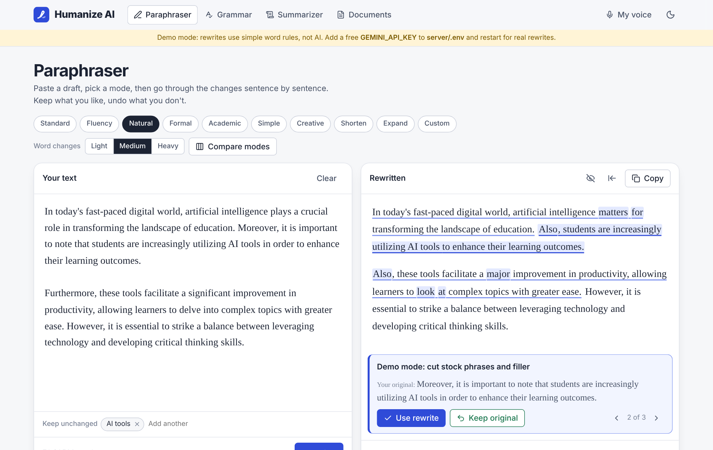
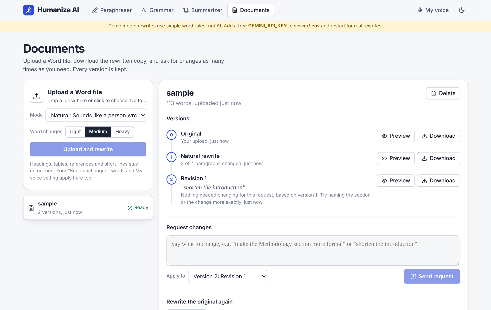
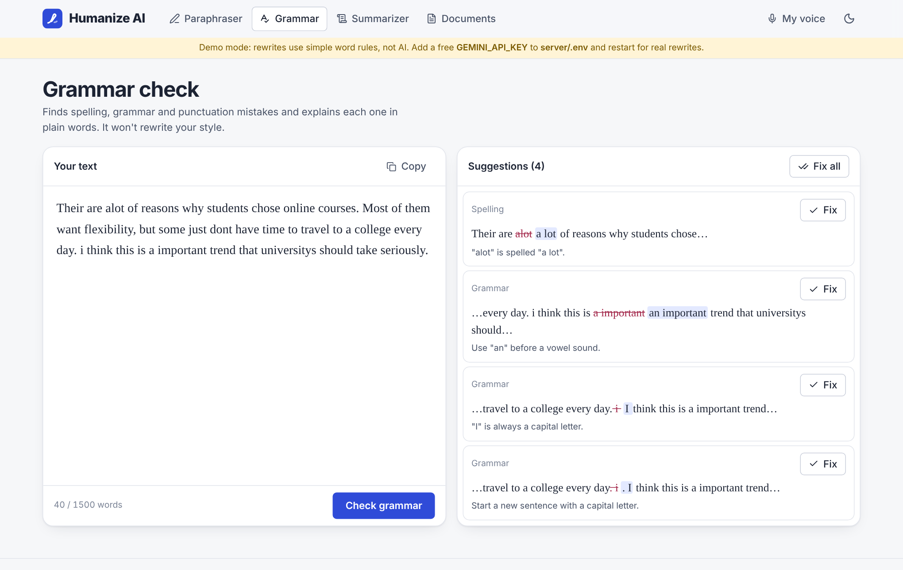
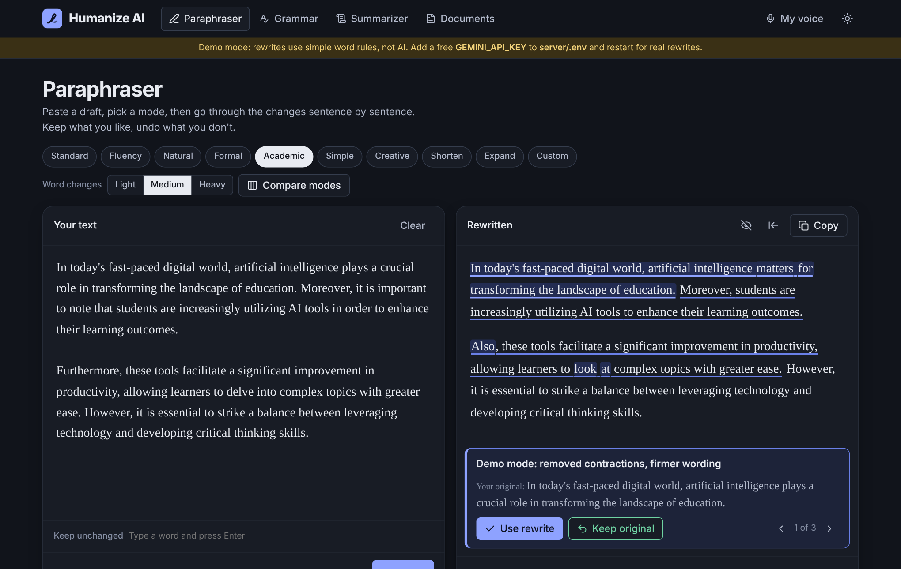

# Humanize AI

A free AI writing suite for students. Paste a stiff or AI-sounding draft and get clear, natural writing back, one sentence at a time, with full control over what changes.



## What it does

| Tool | What you get |
| --- | --- |
| **Paraphraser** | 10 modes (Standard, Fluency, Natural, Formal, Academic, Simple, Creative, Shorten, Expand, Custom). Every changed sentence is marked. Click one to see why it changed and keep your original if you prefer it. |
| **Compare modes** | Run the same text through 2 or 3 modes side by side and pick the best one. |
| **Keep unchanged** | Lock names, technical terms or keywords. If the AI touches one, that sentence is reverted automatically. |
| **My voice** | Paste a sample of your own writing. Rewrites copy your sentence length and word choice instead of sounding generic. |
| **Grammar check** | Finds spelling, grammar and punctuation mistakes, explains each in plain English, and fixes them one by one or all at once. |
| **Summarizer** | Paragraph or key points, short, medium or long, up to 6,000 words at once. |
| **Documents** | Upload a `.docx`, download the rewritten copy with headings, lists and styles kept. Ask for changes in plain words ("make the Methodology section more formal") and every version is saved. |

### Compared with QuillBot's free plan

QuillBot is the tool most students know, so it's the benchmark. Figures are for QuillBot's free plan as reported in November 2026 ([eesel.ai](https://www.eesel.ai/blog/quillbot), [G2](https://www.g2.com/products/quillbot/pricing)).

| | QuillBot free | Humanize AI |
| --- | --- | --- |
| Words per paraphrase | 125 | 1,500 (configurable) |
| Paraphrase modes | 2 | 10, including Custom |
| Freeze words | 1 | 30 |
| Compare modes | Premium only | Free |
| Summarizer | 1,200 words | 6,000 words |
| See why each sentence changed | No | Yes |
| Rewrite a whole Word file and keep versions | No | Yes |

QuillBot is a mature product with far more polish, languages and integrations. This project wins on what its free plan holds back.

## Screenshots

| Documents and version history | Grammar check |
| --- | --- |
|  |  |

Dark mode follows your system setting, or use the moon button.



## Tech stack

- **Frontend:** React 19, Vite, plain CSS with design tokens, `diff` for word-level change marks, `lucide-react` icons
- **Backend:** Node.js, Express 5, Multer (uploads), JSZip and xmldom (editing `.docx` files directly), express-rate-limit
- **AI:** Google Gemini API (free tier) by default, Groq as an alternative. Without a key it runs in demo mode.
- **Database:** MongoDB with Mongoose if you set `MONGO_URI`, otherwise a local JSON file, so it runs with zero setup

## Run it on Windows

You need [Node.js](https://nodejs.org) 20 or newer (LTS is fine).

**Easiest:** double-click `start.bat`. It installs everything the first time, creates `server\.env`, and starts the app. Open http://localhost:5173.

**Or from a terminal** in the project folder:

```bash
npm install
copy server\.env.example server\.env
npm run dev
```

On macOS or Linux use `cp` instead of `copy`.

If PowerShell says "running scripts is disabled", use Command Prompt (`cmd`) instead, or run `npm.cmd install` and `npm.cmd run dev`.

### Turn on real AI

The app starts in **demo mode**: rewrites use simple word rules so you can click through every screen. For real rewrites:

1. Go to [Google AI Studio](https://aistudio.google.com) and click **Get API key**. It's free.
2. Open `server\.env` and paste it: `GEMINI_API_KEY=your-key-here`
3. Stop the app (`Ctrl + C`) and run `npm run dev` again. The yellow demo banner disappears.

The default model is `gemini-3.5-flash-lite`, which has the most generous free quota. Google changes model names and free limits often, so if you get a "model not found" error, check the current list in AI Studio and set `GEMINI_MODEL` in `.env`.

Never commit `.env`. It's already in `.gitignore`.

### Production build

```bash
npm run build
npm start
```

The server then serves the built site and the API together on http://localhost:5000.

## How it works

```
React (Vite)  ──/api──▶  Express
                           ├─ /paraphrase, /compare  ─┐
                           ├─ /grammar, /summarize    ├─▶ Gemini / Groq (JSON replies)
                           └─ /documents ─────────────┘
                                 │ JSZip + xmldom edit word/document.xml in place
                                 └─ MongoDB or data/documents.json + data/files/<id>/v<n>.docx
```

- **Sentence-level rewriting.** The server splits text into sentences with `Intl.Segmenter`, sends them as a numbered list, and asks for JSON back with a rewrite and a short reason for each. That's what makes accept/reject per sentence possible.
- **Safety rails in every prompt.** Keep facts, numbers, names, quotes and citations like `(Smith, 2020)` exactly as written. Never invent sources.
- **Word files keep their layout.** Instead of converting to text and back, the server edits the paragraphs inside the `.docx` directly, so styles, headings, lists and tables survive. Headings, tables, text boxes, the References section, and paragraphs with links, footnotes, equations or images are left untouched.
- **Change requests are targeted.** Each paragraph is sent with the heading it sits under, so "make the Methodology section more formal" only changes that section.
- **Long work runs in the background.** Uploads return straight away, and the page polls for progress. Jobs cut off by a server restart are marked failed, not stuck forever.
- **No login, still private.** Each browser gets a random id, and documents are only visible to the browser that uploaded them.

### API

| Method | Path | Body |
| --- | --- | --- |
| GET | `/api/meta` | Provider, limits and modes |
| POST | `/api/paraphrase` | `{ text, mode, synonymLevel, freezeWords, customInstruction, voiceSample }` |
| POST | `/api/compare` | Same as above plus `modes: ["natural","formal"]` |
| POST | `/api/grammar` | `{ text }` |
| POST | `/api/summarize` | `{ text, format: "paragraph"\|"bullets", length: "short"\|"medium"\|"long" }` |
| GET | `/api/documents` | List your documents (header `x-client-id`) |
| POST | `/api/documents` | Multipart: `file` (.docx) plus the paraphrase options |
| POST | `/api/documents/:id/revisions` | `{ note, from }` request changes on a version |
| POST | `/api/documents/:id/rewrites` | `{ mode }` rewrite the original again |
| GET | `/api/documents/:id/versions/:n/preview` | Paragraphs with what changed |
| GET | `/api/documents/:id/versions/:n/download` | The `.docx` file |
| DELETE | `/api/documents/:id` | Delete a document and all versions |

## Known limits

- In a rewritten paragraph, inline formatting such as one bold phrase is flattened to the paragraph's first style. Paragraph styles, headings and lists are kept.
- Only `.docx` is supported. Save `.doc` or Google Docs files as `.docx` first.
- On the free Gemini tier you get a limited number of requests per day. Comparing 3 modes uses 3 requests, and a long document uses one request per ~1,200 words.
- The AI can still change meaning. Read every result before you use it.

## Use it honestly

This is a writing assistant: it helps you say what you mean more clearly. It does not make AI-written work your own, and it makes no promise to get past AI detectors. Follow your institution's rules on AI use.

## License

MIT, © 2026 Siddharth Bhat
